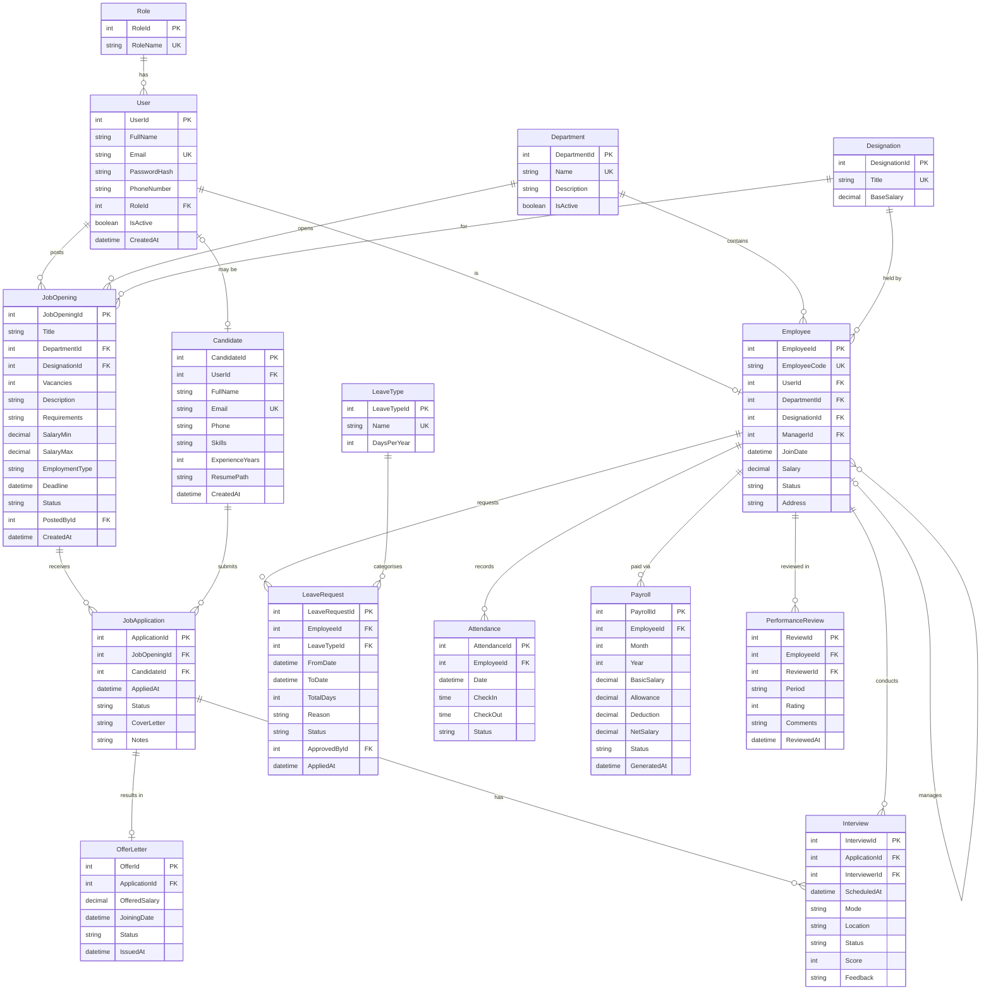

# 2. ER Diagram

Entity-Relationship diagram of the HR & Recruitment system (Mermaid). It renders on GitHub, GitLab, VS Code (Markdown Preview Mermaid extension) and https://mermaid.live .

## Relationship summary

| Parent | Child | Type | Meaning |
|---|---|---|---|
| Role | User | 1 : N | Role has User |
| User | Employee | 1 : 0..1 | User is Employee |
| User | Candidate | 0..1 : 0..1 | User may be Candidate |
| User | JobOpening | 1 : N | User posts JobOpening |
| Department | Employee | 1 : N | Department contains Employee |
| Designation | Employee | 1 : N | Designation held by Employee |
| Department | JobOpening | 1 : N | Department opens JobOpening |
| Designation | JobOpening | 1 : N | Designation for JobOpening |
| Employee | Employee | 0..1 : N | Employee manages Employee |
| JobOpening | JobApplication | 1 : N | JobOpening receives JobApplication |
| Candidate | JobApplication | 1 : N | Candidate submits JobApplication |
| JobApplication | Interview | 1 : N | JobApplication has Interview |
| Employee | Interview | 1 : N | Employee conducts Interview |
| JobApplication | OfferLetter | 1 : 0..1 | JobApplication results in OfferLetter |
| Employee | LeaveRequest | 1 : N | Employee requests LeaveRequest |
| LeaveType | LeaveRequest | 1 : N | LeaveType categorises LeaveRequest |
| Employee | Attendance | 1 : N | Employee records Attendance |
| Employee | Payroll | 1 : N | Employee paid via Payroll |
| Employee | PerformanceReview | 1 : N | Employee reviewed in PerformanceReview |

## Notes

- `User` is the login account. A user may own one `Employee` profile and/or one `Candidate` profile.
- `Employee.ManagerId` is a self reference (manager / subordinate).
- `LeaveRequest` has two links to `Employee`: the requester (`EmployeeId`) and the approver (`ApprovedById`).
- `PerformanceReview` links to `Employee` twice: the reviewed employee and the reviewer.
- `OfferLetter` is 1:1 with `JobApplication`, so one application can have at most one offer.
