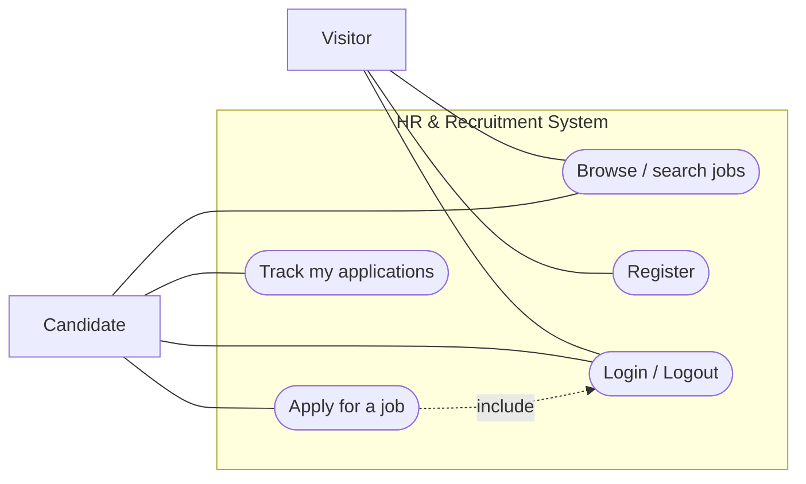
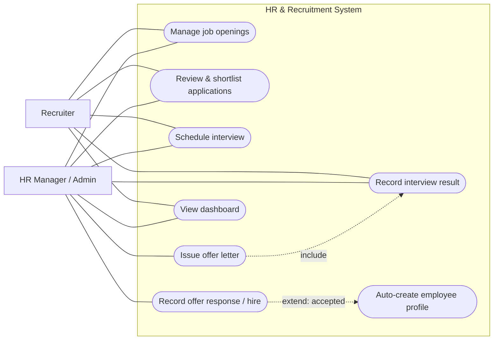
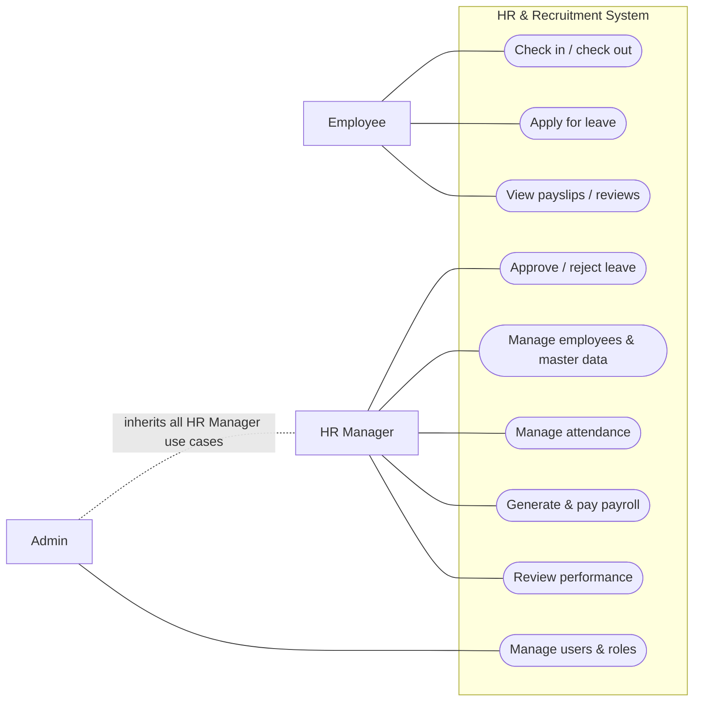

# 3. Use Case

## 3.1 Actors

| Actor | Description |
|---|---|
| Visitor | Anyone not logged in; can only browse jobs, register and log in |
| Candidate | Registered job seeker; applies for jobs and tracks applications |
| Employee | Hired staff; self-service for attendance, leave, payslips, reviews |
| Recruiter | Handles job posts, applications and interviews |
| HR Manager | Everything a recruiter does plus offers, employees, leave approval, payroll, reviews |
| Admin | Everything an HR Manager does plus user and role management |

## 3.2 Use case diagrams (Mermaid)

### A. Candidate portal

### B. Recruitment (Recruiter / HR Manager / Admin)

### C. HR operations (Employee / HR Manager / Admin)

## 3.3 Use case descriptions

| ID | Use case | Actor | Pre-condition | Main flow | Alternate / exception |
|---|---|---|---|---|---|
| UC-01 | Register as candidate | Candidate | Email not used before | Enter name, email, phone, password -> system validates -> creates User (role Candidate) + Candidate profile | Email exists / password < 8 chars -> error shown |
| UC-02 | Login / Logout | All | Account active | Enter email + password -> password hash verified -> cookie issued with role claim -> redirect by role | Wrong credentials or inactive user -> error |
| UC-03 | Browse and search jobs | Visitor, Candidate | - | Open Careers page -> optional search by title/department -> open details | Only Open jobs with deadline >= today are listed |
| UC-04 | Apply for a job | Candidate | Logged in as Candidate; job is Open | Open job -> Apply -> write cover letter -> submit -> application created with status Applied | Duplicate application, closed job or passed deadline -> error |
| UC-05 | Track my applications | Candidate | Logged in | Open My applications -> see job, date, current status | - |
| UC-06 | Manage job openings | Recruiter, HR Manager, Admin | Logged in | Create/edit job (title, department, designation, vacancies, salary range, deadline) -> Publish / Close | Salary max < min, vacancies < 1, past deadline -> error. Delete is HR/Admin only |
| UC-07 | Review and shortlist applications | Recruiter, HR Manager, Admin | Application exists | Open application details -> read candidate profile -> Mark Shortlisted or Rejected | Only legal status transitions are accepted |
| UC-08 | Schedule interview | Recruiter, HR Manager, Admin | Application is Shortlisted/Interview | Choose application, interviewer, date/time, mode -> save -> application becomes Interview | Past time, or interviewer busy within 1 hour -> error |
| UC-09 | Record interview result | Recruiter, HR Manager, Admin | Interview exists | Edit interview -> set status Completed, score 1-10, feedback | Score outside 1-10 -> error |
| UC-10 | Issue offer letter | HR Manager, Admin | Application is in Interview status | Choose application -> salary + joining date -> issue -> application becomes Offered | Second offer for same application -> error |
| UC-11 | Record offer response (hire) | HR Manager, Admin | Offer is Issued | Click Accepted -> application Hired, Employee profile auto-created, user role changed to Employee. Click Declined -> application Rejected | Already answered -> error |
| UC-12 | Manage employees | HR Manager, Admin | Logged in | Create/edit employee (user, department, designation, manager, join date, salary) -> code EMP00001 generated | User already an employee, salary <= 0, self as manager -> error |
| UC-13 | Manage departments, designations, leave types | HR Manager, Admin | Logged in | Create/edit/delete master data | Duplicate name -> error; referenced record cannot be deleted |
| UC-14 | Check in / check out | Employee | Employee profile exists | Click Check in (Late if after 09:40) -> later Check out | Double check-in, check-out without check-in -> error |
| UC-15 | Manage attendance | HR Manager, Admin | Logged in | Create/correct attendance rows for any employee | One row per employee per day |
| UC-16 | Apply for leave | Employee | Employee profile exists | Choose type, from/to, reason -> total days calculated -> status Pending | Overlap with other leave, balance exceeded, past date -> error |
| UC-17 | Approve / reject leave | HR Manager, Admin | Leave is Pending | Click Approve or Reject -> approver recorded | Cannot approve own leave; only Pending can be decided |
| UC-18 | Generate and pay payroll | HR Manager, Admin | Active employees exist | Enter month/year -> Generate for all (basic + 10% allowance - 5% deduction) -> Mark paid | Duplicate month for employee -> skipped / error |
| UC-19 | View my payslips, attendance, leaves, reviews | Employee | Logged in as Employee | Open the page -> only own records are listed | - |
| UC-20 | Review employee performance | HR Manager, Admin | Logged in | Choose employee, reviewer, period, rating 1-5, comments | Self review, rating outside 1-5 -> error |
| UC-21 | Manage users and roles | Admin | Logged in as Admin | Create staff user, change role, activate/deactivate, delete | Cannot demote/deactivate/delete own account |
| UC-22 | View dashboard | Recruiter, HR Manager, Admin | Logged in | See active employees, open jobs, applications, pending leaves, hiring pipeline | - |

## 3.4 Role-permission matrix

| Module | Visitor | Candidate | Employee | Recruiter | HR Manager | Admin |
|---|:-:|:-:|:-:|:-:|:-:|:-:|
| Careers (view jobs) | Y | Y | Y | Y | Y | Y |
| Apply / My applications | - | Y | - | - | - | - |
| Job openings | - | - | - | CRU | CRUD | CRUD |
| Candidates, Applications, Interviews | - | - | - | CRU | CRUD | CRUD |
| Offer letters | - | - | - | R | CRUD + respond | CRUD + respond |
| Employees, Departments, Designations, Leave types | - | - | - | - | CRUD | CRUD |
| Leave requests | - | - | own: C R | - | CRUD + approve | CRUD + approve |
| Attendance | - | - | own: R + check in/out | - | CRUD | CRUD |
| Payroll | - | - | own: R | - | CRUD + generate/pay | CRUD + generate/pay |
| Performance reviews | - | - | own: R | - | CRUD | CRUD |
| Users and roles | - | - | - | - | - | CRUD |

C = create, R = read, U = update, D = delete.
